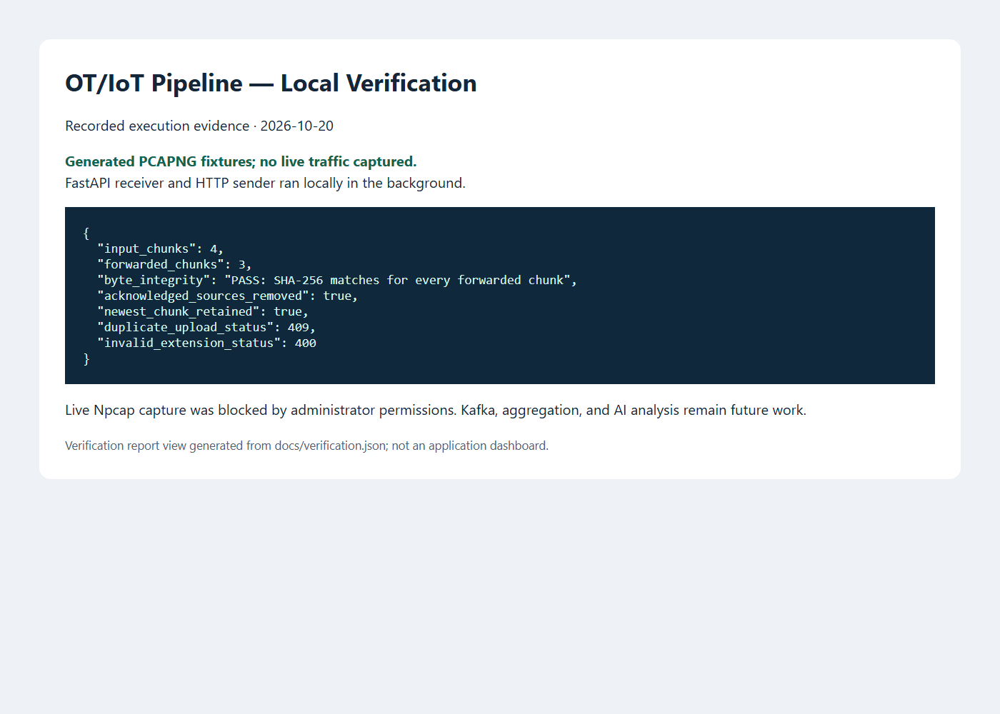
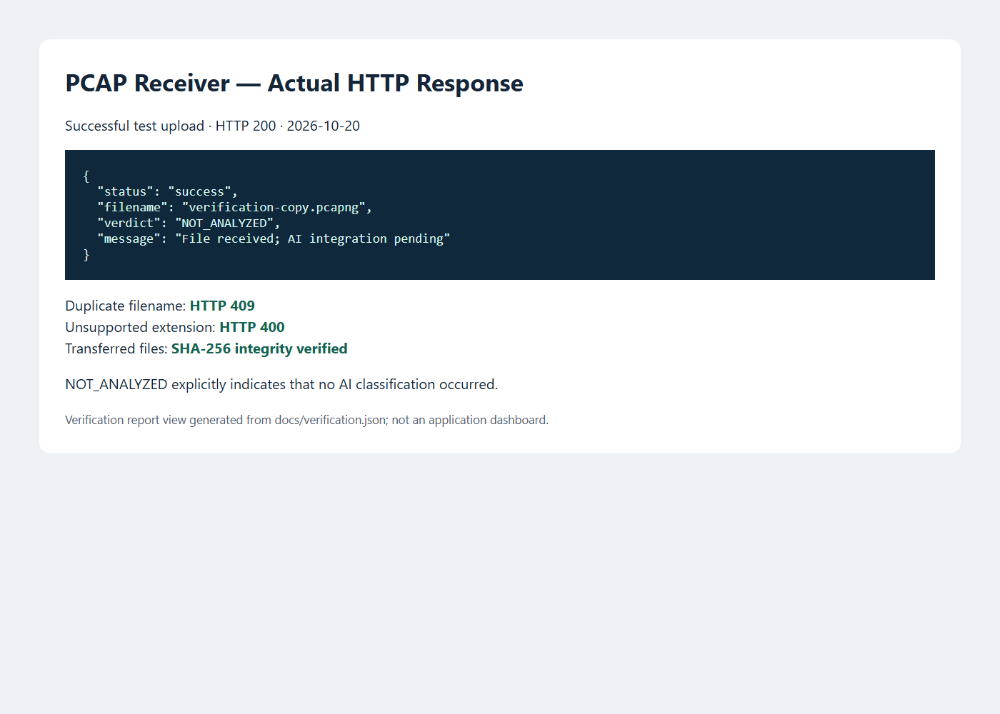

# OT/IoT Security Pipeline — Baseline V1

A Python prototype for time-windowed PCAPNG capture, buffered HTTP forwarding, and local file reception. This is the first stage of an OT/IoT security-monitoring architecture.

**Implemented:** dumpcap capture launcher, rotating capture files, polling sender, FastAPI upload receiver, and reproducible local integration checks.

**Planned:** Kafka transport, flow aggregation, protocol analysis, AI classification, and a policy feedback loop. The receiver returns `NOT_ANALYZED`; it does not classify threats.

## Current architecture

```text
authorized interface -> dumpcap -> rotating PCAPNG files
                                  -> polling HTTP sender
                                  -> FastAPI /analyze
                                  -> received file + JSON acknowledgement
```

The architecture reference supplied during development describes a future target. It is not included as implementation evidence.

## Verified local execution

On October 20, 2026, the receiver and sender were run on Windows with Python 3.13 using generated Ethernet/IPv4/UDP PCAPNG fixtures. No personal network traffic is included in this repository.

- Four input files; three forwarded and one retained by the newest-file heuristic.
- SHA-256 matched for every forwarded file.
- Acknowledged source files were removed.
- Duplicate filenames returned HTTP 409; unsupported extensions returned HTTP 400.
- A valid upload returned HTTP 200 with `NOT_ANALYZED`.
- Wireshark capinfos recognized the generated fixture as Ethernet PCAPNG containing one packet.
- Live loopback capture was attempted but blocked by Npcap administrator permissions. Live capture/rotation was therefore not verified.

These are headless-browser screenshots of a report generated from the actual test output, **not a product dashboard or AI results**. Machine-readable evidence is in [docs/verification.json](docs/verification.json).





## Files

| File | Purpose |
|---|---|
| `capture_agent.py` | Launch dumpcap with configurable interface, rotation, filter and optional bounded duration |
| `pipeline_sender.py` | Forward older PCAPNG chunks and remove acknowledged sources |
| `main.py` | Receive uploads; reject filename conflicts and unsupported extensions |
| `verify_local.py` | Exercise receiver/sender using generated fixtures, or bounded loopback capture with `--live` |
| `requirements-lock.txt` | Exact dependency versions used for this verification |

## Setup

```powershell
py -3.13 -m venv .venv
.\.venv\Scripts\python.exe -m pip install -r requirements-lock.txt
```

For a dependency installation without exact version pins, use `requirements.txt` instead.

### Reproduce the verified test

```powershell
.\.venv\Scripts\python.exe verify_local.py
```

Runs the receiver at `127.0.0.1:18765`, generates local fixtures, starts the sender, checks outcomes, writes `docs/verification.json`, and stops its child processes. Raw files/logs remain in an ignored `runtime/` directory. The default test does not require Wireshark or administrator access.

### Run with live capture

Install Wireshark and Npcap first. Capture only traffic you are authorized to observe. In each terminal, set the same `WATCH_DIR` if overriding it.

Terminal 1 — receiver:
```powershell
$env:RECEIVED_DIR = 'runtime/received'
.\.venv\Scripts\python.exe -m uvicorn main:app --host 127.0.0.1 --port 8000
```

Terminal 2 — capture:
```powershell
$env:DUMPCAP_PATH = 'C:\Program Files\Wireshark\dumpcap.exe'
& $env:DUMPCAP_PATH -D
$env:CAPTURE_INTERFACE = '1' # Replace with the intended interface from the list
$env:WATCH_DIR = 'runtime/buffer'
$env:CAPTURE_WINDOW_SECONDS = '10'
.\.venv\Scripts\python.exe capture_agent.py
```

Terminal 3 — sender:
```powershell
$env:WATCH_DIR = 'runtime/buffer'
$env:AI_API_URL = 'http://127.0.0.1:8000/analyze'
.\.venv\Scripts\python.exe pipeline_sender.py
```

Receiver readiness: `http://127.0.0.1:8000/`. API documentation: `http://127.0.0.1:8000/docs`.

Optional capture environment variables: `CAPTURE_FILTER` (dumpcap BPF expression) and `CAPTURE_DURATION_SECONDS` (stop after a bounded interval). The bounded `verify_local.py --live` check uses interface 1 and local TCP port 18765; verify interface 1 is loopback before running it. If Npcap is installed in administrator-only mode, live capture requires appropriate permissions.

## Limitations

- File-based micro-batching, not packet-by-packet broker streaming.
- No Kafka, flow reassembly, aggregation, threat detection, or AI verdicts.
- The newest-file heuristic does not prove a file is closed and leaves the final chunk unsent.
- No authentication, content validation beyond extension, upload limits, quotas, or production durability guarantees.
- Acknowledgements confirm reception only; ambiguous retries can produce filename conflicts.
- Single synchronous sender; latency, throughput, scalability and packet loss are not benchmarked.
- Intended for local development; do not expose the receiver as a production service.

## Next milestone

Introduce durable transport and idempotent delivery, replace the file-closure heuristic, implement flow-aware aggregation, and measure backlog, latency and resource use before adding analysis workers.
